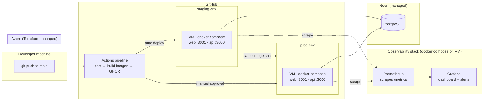

# Lumen Health — Platform Architecture

## Components

- **Web** — Next.js app, port 3001 (docker compose service `web`)
- **API** — Hono server, port 3000, exposes `/health` `/ready` `/metrics`
  `/version` `/__debug/fault` (docker compose service `server`)
- **Database** — Neon managed Postgres, shared connection string via
  `DATABASE_URL` secret (never in the repo)
- **Terraform** — builds RG/VNet/NSG/VM per environment from
  `infra/terraform`; staging and prod differ only in `*.tfvars`
- **CI/CD** — GitHub Actions: test → build + push `web`/`server` images to
  GHCR → deploy staging → approval gate → deploy prod (same image tag)
- **Monitoring** — Prometheus scrapes the API `/metrics`; Grafana shows
  up/down, error rate, latency; ≥2 alert rules
- **Recovery** — rollback = redeploy previous image tag; fault injection
  via `/__debug/fault` drives the game day
